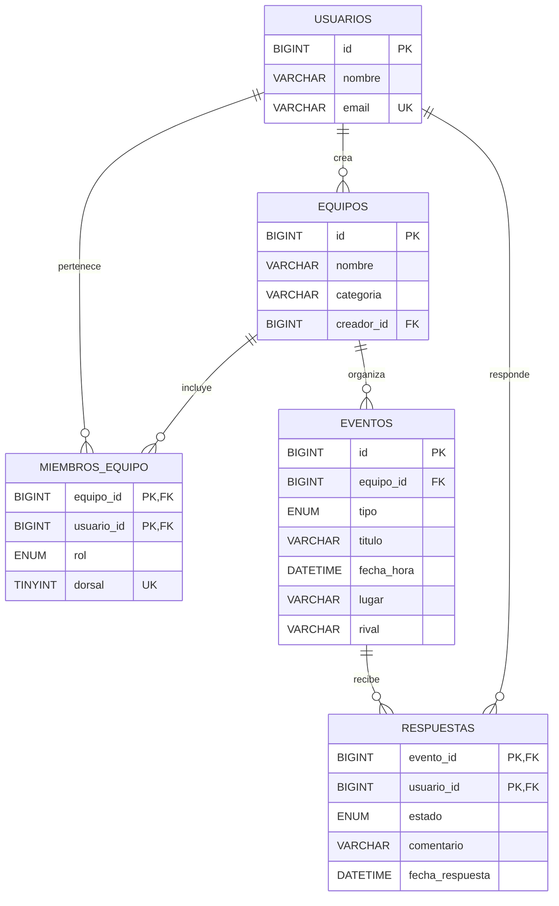
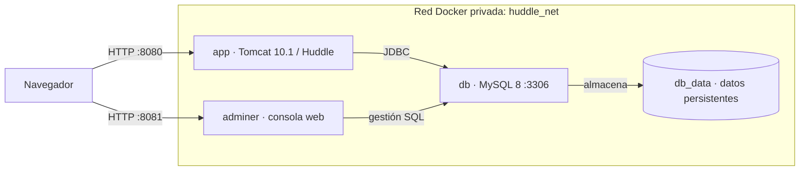

# Huddle

Huddle es una aplicación web para organizar equipos de baloncesto, sus plantillas y eventos. Entrenadores y jugadores pueden consultar entrenamientos y partidos, gestionar miembros y registrar la asistencia como **VOY**, **NO_VOY** o **QUIZAS**.

La aplicación está desarrollada con Java 17, Servlets Jakarta sobre Tomcat 10.1, JDBC y MySQL 8. El frontend utiliza HTML, CSS y JavaScript nativo; la API intercambia JSON y la persistencia se realiza mediante DAOs JDBC.

## Funcionalidades

- Crear equipos y administrar sus miembros y dorsales.
- Crear, consultar y gestionar entrenamientos y partidos.
- Responder y actualizar la asistencia a eventos y consultar el resumen de respuestas.
- Iniciar una sesión de demostración por email y cambiar entre los usuarios de ejemplo.
- Consultar y editar el nombre del perfil, y acceder a las páginas de ayuda y uso.

Los wireframes de referencia están en [`docs/wireframes/`](docs/wireframes/).

## Modelo de datos

El esquema está en [`db/init.sql`](db/init.sql). Las claves foráneas implementan las relaciones entre usuarios, equipos, miembros, eventos y respuestas.



La pareja `(equipo_id, usuario_id)` identifica a cada miembro y la pareja `(evento_id, usuario_id)` identifica una respuesta. El email es único y el dorsal no se repite dentro del mismo equipo.

## Arquitectura de contenedores

`docker compose` crea una red privada `huddle_net`. El navegador accede a la aplicación y a Adminer a través de los puertos publicados; la aplicación y Adminer se conectan a MySQL por la red interna. El volumen nombrado `db_data` conserva la base de datos.



MySQL no publica un puerto en el host con la configuración predeterminada. El puerto `3306` es interno a Docker; consulta [Publicar MySQL en el host](#publicar-mysql-en-el-host-opcional) si necesitas acceder desde una herramienta local.

## Arquitectura de la aplicación

La aplicación Java está organizada en capas con el flujo `Controller → Service → DAO → Base de datos`. Los controladores y las respuestas JSON trabajan con DTOs; las entidades del modelo no se exponen directamente en la API.

- `config`: inicialización de dependencias y `DataSource` HikariCP.
- `controller`: Servlets REST, serialización JSON y manejo centralizado de errores.
- `service`: validación, reglas de negocio, permisos y transacciones.
- `dao`: interfaces y persistencia JDBC mediante `PreparedStatement`.
- `dto`: objetos de entrada y salida y mapeadores.
- `model`: entidades y enumeraciones del dominio.
- `filter`: filtros HTTP, incluido el usuario de la sesión simulada y codificación UTF-8.
- `exception`: excepciones de aplicación y de acceso a datos.
- `util`: utilidades JSON y gestión de transacciones.
- `src/main/webapp`: páginas HTML, hojas de estilo y módulos JavaScript.

La configuración de base de datos se inyecta al contenedor desde variables de entorno. `DataSourceProvider` construye el pool HikariCP con las variables `DB_*`; no incluye credenciales en el código.

## Requisitos

- Docker Desktop instalado y en ejecución, con Docker Compose.
- Para ejecutar los tests desde el equipo: Java 17 y Maven.

## Configuración y ejecución

1. Crea el archivo local `.env` a partir de la plantilla:

   ```powershell
   Copy-Item .env.example .env
   ```

   En Linux o macOS, el comando equivalente es `cp .env.example .env`.

2. Revisa y, si es necesario, modifica los valores de desarrollo en `.env`.
3. Desde la raíz del proyecto, construye y levanta los servicios:

   ```console
   docker compose up --build -d
   ```

4. Abre [`http://localhost:8080/`](http://localhost:8080/) o [`http://localhost:8080/login.html`](http://localhost:8080/login.html). Adminer está disponible en [`http://localhost:8081/`](http://localhost:8081/).

El servicio `app` espera a que el healthcheck de MySQL indique que la base de datos está lista. En el primer inicio, MySQL ejecuta `db/init.sql` y carga el esquema y los usuarios de demostración.

### Variables de entorno

Los valores de ejemplo son para desarrollo local; cambia las contraseñas antes de cualquier despliegue no local. `.env` está excluido del repositorio.

| Variable | Ejemplo | Uso |
|---|---:|---|
| `MYSQL_DATABASE` | `huddle` | Nombre de la base de datos creada por MySQL y usada por la aplicación como `DB_NAME`. |
| `MYSQL_USER` | `huddle` | Usuario de la aplicación en MySQL; se inyecta como `DB_USER`. |
| `MYSQL_PASSWORD` | `huddle_dev_password` | Contraseña de ese usuario; se inyecta como `DB_PASSWORD`. |
| `MYSQL_ROOT_PASSWORD` | `root_dev_password` | Contraseña root de MySQL para tareas administrativas. |
| `DB_PORT` | `3306` | Puerto de MySQL al que se conecta la aplicación dentro de Docker. |
| `DB_POOL_SIZE` | `10` | Tamaño máximo del pool de conexiones HikariCP. |
| `APP_PORT` | `8080` | Puerto del host publicado para la aplicación web. |
| `ADMINER_PORT` | `8081` | Puerto del host publicado para Adminer. |
| `DB_PUBLISH_PORT` | `3306` | Puerto opcional del host para publicar MySQL al activar el Compose overlay. |
| `COMPOSE_FILE` | Depende del sistema | Permite cargar el Compose principal y el overlay para publicar MySQL. No hace falta para el uso normal. |

El Compose configura `DB_HOST=db` para la aplicación: es el nombre del servicio MySQL dentro de la red, no una variable que haya que cambiar en `.env`.

### Publicar MySQL en el host (opcional)

La base de datos no se expone al host de forma predeterminada. Para habilitar el overlay `docker-compose.db-public.yml`, configura `COMPOSE_FILE` en `.env` con el separador apropiado:

```dotenv
# Windows
COMPOSE_FILE=docker-compose.yml;docker-compose.db-public.yml

# Linux o macOS (usa esta línea en lugar de la anterior)
COMPOSE_FILE=docker-compose.yml:docker-compose.db-public.yml
```

Opcionalmente, define `DB_PUBLISH_PORT` para elegir el puerto del host (por defecto, `3306`) y vuelve a ejecutar `docker compose up -d`. No publiques MySQL en redes no confiables.

## Usuarios de prueba y puertos

El script inicial crea, entre otros, estos usuarios:

| Nombre | Email | Ejemplo de rol |
|---|---|---|
| Carlos Ruiz | `carlos.ruiz@example.com` | Entrenador de Minibasket 2016 y Minibasket 2018; jugador en Cadete Femenino. |
| Pablo Gil | `pablo.gil@example.com` | Jugador de Minibasket 2016. Es el email sugerido en la pantalla de acceso. |
| Sofía Gil | `sofia.gil@example.com` | Entrenadora de Cadete Femenino. |

El acceso de demostración **no utiliza contraseña**: basta con introducir el email de una cuenta existente. No es autenticación real y no debe usarse para proteger datos sensibles.

| Servicio | URL/puerto local | Nota |
|---|---|---|
| Huddle | `http://localhost:8080/` | Puerto predeterminado; configurable con `APP_PORT`. |
| Adminer | `http://localhost:8081/` | Puerto predeterminado; configurable con `ADMINER_PORT`. |
| MySQL | `3306` | Solo dentro de Docker por defecto; se publica opcionalmente mediante el overlay. |

Para iniciar sesión en Adminer, usa servidor `db`, usuario `huddle`, contraseña `huddle_dev_password` y base de datos `huddle` (si no has cambiado los valores del `.env`).

## Manual breve de uso

1. Entra con `carlos.ruiz@example.com` para probar el flujo de entrenador. Desde **Mis equipos** puedes consultar sus equipos, crear uno nuevo y abrir su plantilla o eventos.
2. En un equipo, añade jugadores por el email con el que se han registrado y asigna un dorsal. Crea un evento como entrenamiento o partido; los partidos requieren rival.
3. Cierra sesión desde el menú del perfil y entra como `pablo.gil@example.com` para probar el flujo de jugador. Abre un evento futuro, selecciona **VOY**, **NO_VOY** o **QUIZAS** y guarda la respuesta.
4. Vuelve a entrar como entrenador para consultar el resumen de asistencia. Puedes cambiar de usuario cerrando sesión y escribiendo el email de otra cuenta de prueba.

## Ejecución de tests

Desde la raíz del repositorio, con Java 17, Maven y Docker Desktop abierto (Testcontainers necesita un motor Docker disponible), ejecuta:

```console
mvn test
```

Las pruebas unitarias de servicios utilizan Mockito. Las pruebas de integración de los DAO levantan MySQL mediante Testcontainers y verifican las operaciones de persistencia contra la base de datos.

## Persistencia demostrada

Los datos se guardan en el volumen nombrado `db_data`, que sobrevive a la eliminación de los contenedores:

```console
docker compose down
docker compose up --build -d
```

Al volver a levantar los servicios, los datos previamente guardados se conservan. Para borrar el volumen y reiniciar la base de datos, incluido el borrado de todos los datos creados, ejecuta:

```console
docker compose down -v
docker compose up --build -d
```

Al recrearse el volumen vacío, MySQL vuelve a ejecutar `db/init.sql` y carga los datos de ejemplo. **`down -v` es destructivo:** elimina los datos persistidos.

## Limitaciones conocidas

El acceso es una **sesión simulada sin contraseña ni autenticación real**. El login identifica la cuenta por email; el navegador guarda `usuarioId`, `nombre` y `email` en `localStorage` y `js/api.js` envía `usuarioId` en la cabecera `X-Usuario-Id`. Cerrar sesión elimina esos datos del navegador. Esta demostración no protege frente a suplantación de identidad y no debe utilizarse como autenticación en producción.
